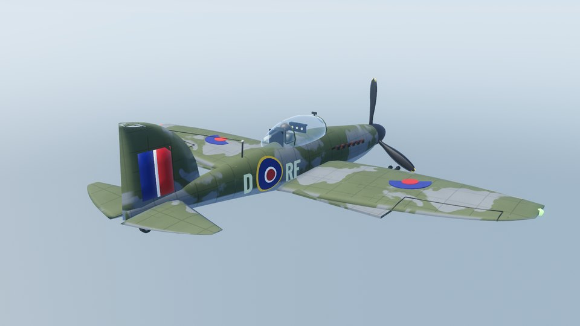
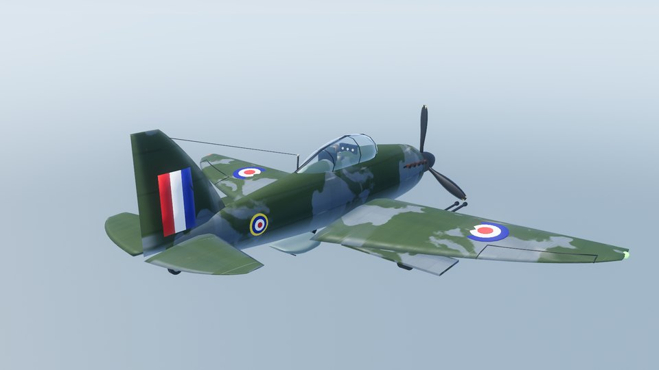
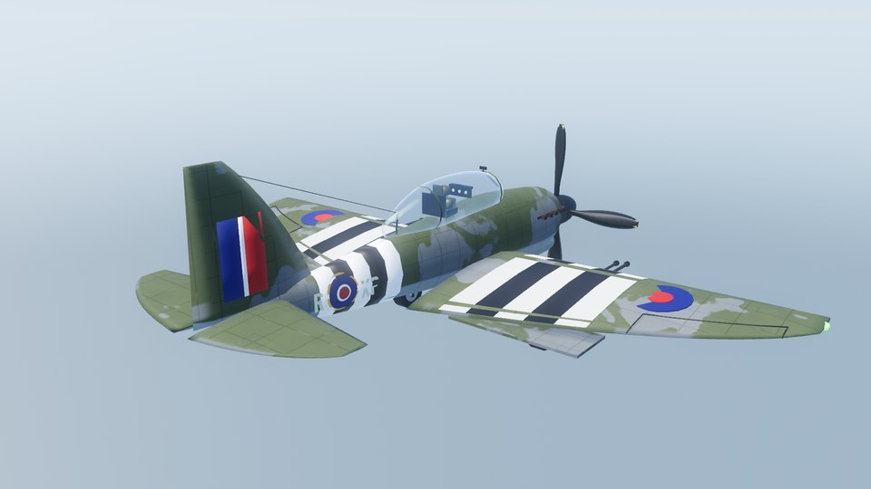
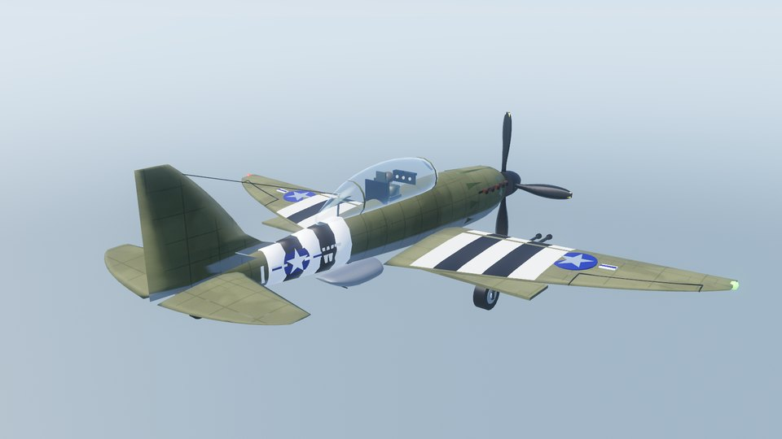
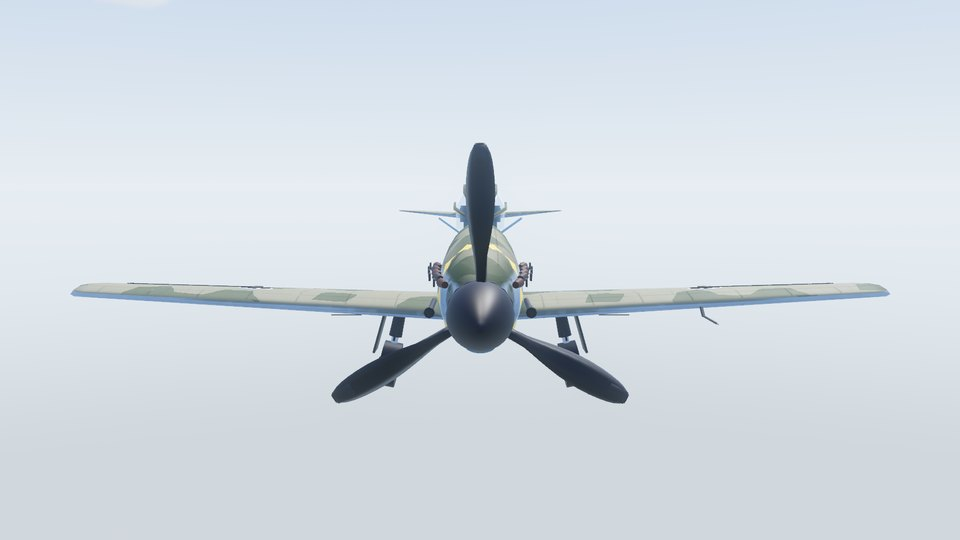
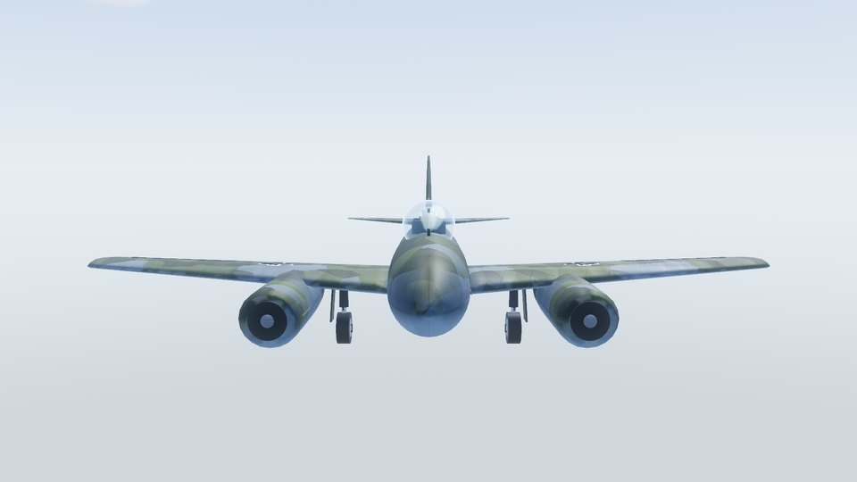
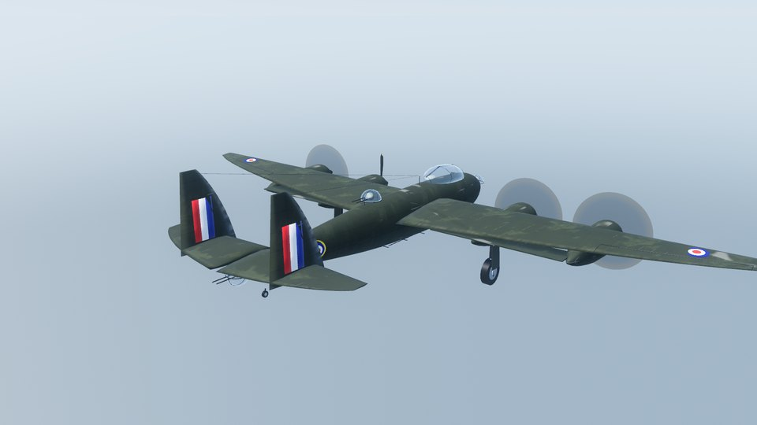
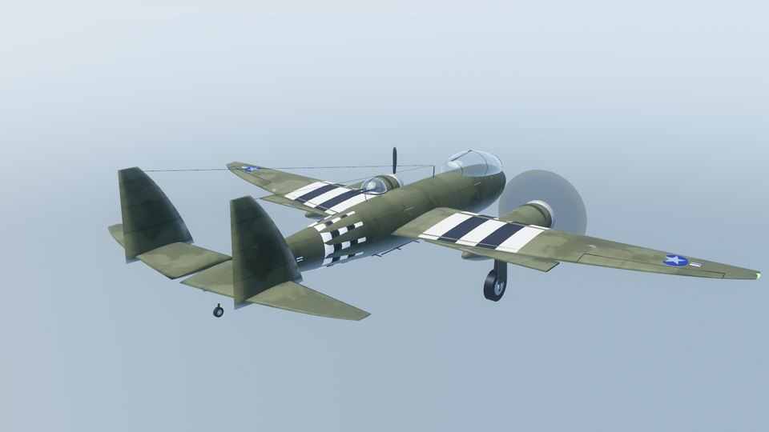
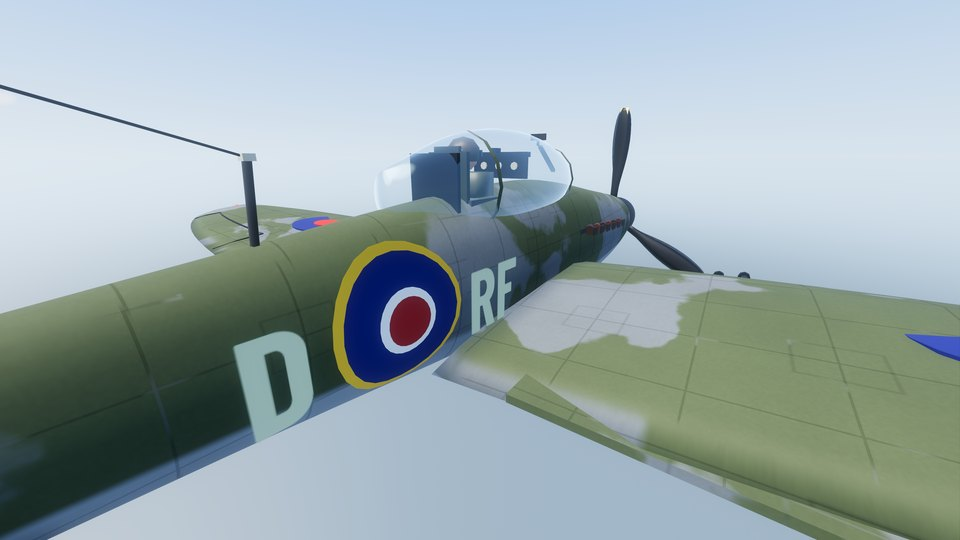
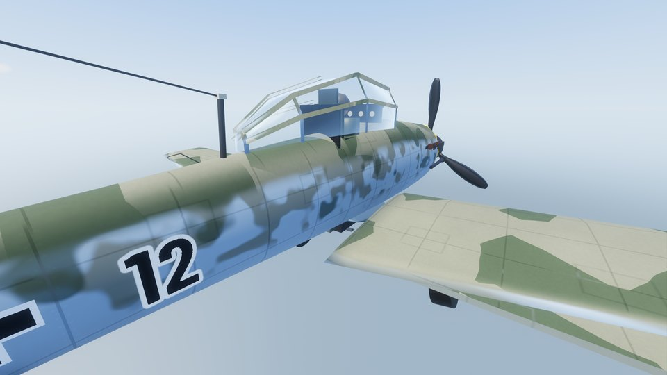

# ✈️ WW2 Channel Air War

**A free, WW2 flight game over a real-scale slice of Europe.** 

Any suggestions or feedback? Let me know!

   

**▶ [Watch the in-game highlights reel](docs/promo/highlights.mp4)** (real gameplay: day, sunset and night flying, combat, G effects and bailing out)

### [⬇️ Download the installer](../../releases/latest)

> 🎵 **Recommended: play it with your own music.** The game ships with royalty-free tracks, but it really comes alive with something like the *Battle of Britain* film soundtrack (or any WW2-era score you own) playing over the Channel.
> **How:** start the game, open **Options > Music**, pick **MENU MUSIC** (start screen) or **IN-GAME MUSIC** (flying), press **Import...** and choose your MP3, OGG or WAV files. Keep **Shuffle: On** to mix them, or turn it off to play in order. Use **Delete** to remove tracks you no longer want.
> Your files are copied into the game's own music folder, so the originals stay where they are. The game does not include any commercial soundtrack: bring your own.

---

## 🔥 Why you'll want to play

|  |  |
|---|---|
| 🌍 **Real-scale Europe** | England, the Channel, France, Belgium, the Netherlands and the Rhineland. Real airfields, towns, rivers, rail and ports.|
| ✈️ **Two sides, two dozen aircraft** | Spitfire, Hurricane, Typhoon, Mustang, Lancaster and more for the Allies. Bf 109, Fw 190, Stuka, Me 262 and more for the Axis. Each one flies differently. |
| ⚔️ **Fly it your way** | Dogfights, bombing runs, ground attack, escorts, sweeps and dynamic missions in free flight.  |
| 🌦️ **Dawn to midnight, clear to storm** | Weather and time of day change everything: fog banks, volumetric clouds, rain squalls, searchlights and flak at night.|
| 🧑‍✈️ **Bail out and live** |  Where you land decides your fate: rescued, rowed out of the Channel, or taken prisoner. |
| 🌡️ **Realism options** | Engine overheating with its own HEAT gauge, and G-forces that grey out your vision and can knock you out. Enemy pilots suffer too. On by default, switch off any time in Options > Realism. |
| 🗓️ **The map follows the war** | Choose your sortie date and the ground changes with it: bomb damage that builds up through the Blitz and the bombing of Germany, the 1944 invasion build-up, Normandy after D-Day, flooded valleys, the Westwall, and bridges that fall on the day they did. Bocage, open fields, polders and the Weald, with the seasons on the farmland. |
| 🏕️ **A living wartime map** | 116 real airfields in RAF and Luftwaffe styles, with gun pits, blast pens and dispersals. Wired army camps packed with tanks under camouflage nets, tent lines, ammo bays and fuel dumps.|
| 🎵 **Soundtrack** | 15 royalty-free orchestral and big-band tracks, separate Allied and Axis victory music, or import your own MP3, OGG or WAV tracks (Options > Music) and fly to your own playlist. |
| 💸 **Free. Really.** | No ads, no accounts, no microtransactions. If you enjoy it, [there's a tip jar](#-support). |

## 🎮 Play it in 3 steps

1. Download **`WW2ChannelAirWar_Setup_v2.75.exe`** from [Releases](../../releases/latest) (or the zip if you like things portable).

2. Run it. It installs just for you, with no admin rights needed.

**Upscaling:** the game uses AMD FSR 2 (Options > Render) to render at a lower resolution and sharpen it back up, which works on any modern graphics card. Turn it off for native resolution.

## ✈️ The aircraft

| | |
|---|---|
|  |  |
| **Supermarine Spitfire** | **Hawker Hurricane** |
|  |  |
| **Hawker Typhoon** | **North American P-51 Mustang** |
|  |  |
| **Messerschmitt Bf 109** | **Messerschmitt Me 262** |
|  |  |
| **Avro Lancaster** | **North American B-25 Mitchell** |
|  |  |
| **Close up: C1 roundel, squadron codes, panel seams** | **Close up: Bf 109 mottled sides and outlined number** |

## 🙏 Credits & attribution

Aircraft, terrain, sea, sky, clouds and HUD are generated procedurally in code. The sources below are the third-party tools, data and sound that the game uses. The complete, per-file list (with every dataset source) is in [ATTRIBUTION.md](ATTRIBUTION.md).

### How it was made
- **Vibe-coded with [Claude](https://claude.ai)** (Anthropic's AI assistant, via [Claude Code](https://claude.com/claude-code)). The game's code, procedural art and tooling were written by Claude working to my direction and testing, not hand-coded line by line.
- **The source is open and in this repository** so anyone can read it, build it and check for themselves what it does. If you spot something wrong or unsafe, please open an issue.

### Engine
- **[Godot Engine](https://godotengine.org)** — the game engine this is built on. © Juan Linietsky, Ariel Manzur and the Godot Engine contributors, [MIT licence](https://godotengine.org/license/).
- **[Ocean3D Lite](https://store.godotengine.org/asset/ocean3d/ocean3d-lite/)** — Gerstner wave field for the sea, by Justin Schroeder, MIT licence (bundled in `addons/ocean3d_lite/`).
- **Fonts:** [Barlow](https://github.com/jpt/barlow) and Barlow Condensed by Jeremy Tribby, [SIL Open Font License 1.1](https://openfontlicense.org).

### Map & terrain data
- **Terrain colour:** [Sentinel-2 cloudless 2020](https://s2maps.eu) by [EOX IT Services GmbH](https://eox.at) — contains modified Copernicus Sentinel data 2020, [CC BY 4.0](https://creativecommons.org/licenses/by/4.0/).
- **Land cover:** [ESA WorldCover 10 m 2021 v200](https://esa-worldcover.org) — © ESA WorldCover project 2021, contains modified Copernicus Sentinel data (2021) processed by ESA, CC BY 4.0.
- **Elevation:** [AWS Terrain Tiles](https://registry.opendata.aws/terrain-tiles/) (Mapzen / AWS Open Data).
- **Roads, rails, rivers, coast, woods and towns:** © [OpenStreetMap contributors](https://www.openstreetmap.org/copyright), [ODbL](https://opendatacommons.org/licenses/odbl/); rivers via the Overpass API, regional extracts from [Geofabrik](https://download.geofabrik.de/).

### 1940s datasets
The 1940s datasets (industry, docks, landmarks, sea defences, dams, decoys, pylons, railway viaducts, oil and fuel, aircraft factories, V-weapon sites, ports, rural Kent, coastal landmarks, civil defence, airship and seaplane stations, forestry, navigation aids and military camps) are hand-authored by the scripts in `tools/`. Every row cites its source for the real position, and no third-party data file was copied. The main references are:
- [Wikipedia](https://www.wikipedia.org) (CC BY-SA 4.0)
- [Airfield Research Group](https://www.airfieldresearchgroup.org.uk)
- [Suffolk Heritage Explorer](https://heritage.suffolk.gov.uk)
- [Heritage Gateway](https://www.heritagegateway.org.uk) / Historic England Research Records
- Ordnance Survey "A guide to coordinate systems in Great Britain" (OSGB36 → WGS84 transform)

Aircraft performance figures are rounded from published specifications: [Wikipedia](https://www.wikipedia.org) and [battleofbritain1940.com](https://battleofbritain1940.com). The De Havilland Dragon Rapide uses dimensions from Wikipedia, The de Havilland Aircraft Museum and the Shuttleworth Collection. D-Day airborne zones follow Wikipedia (Operation Tonga, Deadstick, Mallard and Chicago). The POW escape missions are a what-if; no concentration or extermination camps are depicted.

### Voices & art
- **Voices:** all radio, briefing, training and crew voices are AI text-to-speech generated with [ElevenLabs](https://elevenlabs.io). There are no human recordings.
- **Menu paintings** are AI-generated; no photographic content.

### Music
All tracks are royalty-free from [Pixabay](https://pixabay.com) under the [Pixabay Content License](https://pixabay.com/service/license-summary/). Check each track's page before any commercial release.

| Artist | Tracks |
|---|---|
| [jeremusic70](https://pixabay.com/users/jeremusic70-25199461/) | "Freedom" |
| [nocopyrightsound633](https://pixabay.com/users/nocopyrightsound633-47610058/) | "Rise of Shadows", "Race Against Time", "Cinematic Violin Tribal", "Rise of the Titans", "Battle Cry of the Brave" |
| [musicwallah](https://pixabay.com/users/musicwallah-51797968/) | "Cinematic Action Movie Music", "Epic Orchestral Music with Flute", "Suspenseful Thriller Music" |
| [The_Mountain](https://pixabay.com/users/the_mountain-3616498/) | "Cinematic War", "Trailer War" |
| [YevhenAstafiev](https://pixabay.com/users/yevhenastafiev-52618283/) | "Military - War Military", "Epic - Epic Battle" |
| [NastelBom](https://pixabay.com/users/nastelbom-48128234/) | "Hero Heroic Patriotic" |
| [MUPHFI](https://pixabay.com/users/muphfi-36181755/) | "Danger and Resolution" |
| [Luis_Humanoide](https://pixabay.com/users/luis_humanoide-12661853/) | "Remembering Our Veterans - Heroic Cinematic Music" (menu) |
| [kaazoom](https://pixabay.com/users/kaazoom-448850/) | "Swing That Jazz - 1940s Big Band Dance Music" (menu) |
| [DesiFreeMusic](https://pixabay.com/users/desifreemusic-28163210/) | "Epic Military March – Heroic Snare Drum Theme" (Axis victory) |
