

# ✈️ WW2 Channel Air War

### *"Scramble! Bandits over Dover, angels fifteen!"*

**A free, WW2 flight game over a real-scale slice of Europe.** 
Take off from Kent. Cross the Channel. Come home. Maybe.

Any suggestions or feedback? Let me know!

   

**▶ [Watch the full promo with music](docs/promo/channel-air-war-promo.mp4)**

**▶ [Watch the in-game highlights reel](docs/promo/highlights.mp4)** (real gameplay: day, sunset and night flying, combat, G effects and bailing out)

### [⬇️ Download the free installer](../../releases/latest)

**New in v2.4: [the war on the ground](#%EF%B8%8F-the-war-on-the-ground).** Pick a date and the map shows that day of the war: Blitz damage, the 1944 build-up, Normandy with the Mulberry harbours, floods, the Westwall, and farmland that changes with the region and the season. It runs faster too, up to 40% more FPS over London and the Ruhr.

---

## 🔥 Why you'll want to play

|  |  |
|---|---|
| 🌍 **Real-scale Europe** | **954 × 453 km** of England, the Channel, France, Belgium, the Netherlands and the Rhineland. Real airfields, towns, rivers, rail and ports. Fly from Kent to the Ruhr and it actually takes a while. |
| ✈️ **Two sides, two dozen aircraft** | Spitfire, Hurricane, Typhoon, Mustang, Lancaster and more for the Allies. Bf 109, Fw 190, Stuka, Me 262 and more for the Axis. Each one flies differently. |
| ⚔️ **Fly it your way** | Dogfights, bombing runs, ground attack, escorts, sweeps and free flight. Or just go sightseeing over the white cliffs. |
| 🌊 **Dam Busters** | A seven-day campaign. Skim low, hit your marks, put the bomb on the dam. |
| 🪂 **D-Day airborne** | In a C-47: drop sticks of paratroopers onto the zones, or tow a Horsa or Waco glider with the rope in view and cast it off in reach of the landing zone. |
| 🕯️ **POW escape** | What-if clandestine ops: scout a camp by day, then fly a civil Dragon Rapide in low and slow at night under cloud, land on a field strip, pick up the escapers and get home quietly. |
| 🎖️ **A war that moves** | Dynamic campaign and Pilot's Life: ranks, medals, telegrams, newsreels, and the occasional letter home you hope you never have to send. |
| 🌦️ **Dawn to midnight, clear to storm** | Weather and time of day change everything: fog banks, rain squalls, searchlights and flak at night. |
| 🧑‍✈️ **Bail out and live** | Hold `J` to jump. A detailed pilot (RAF or Luftwaffe kit, cloth and leather textures) swings under the canopy with rag-doll motion, and every man aboard gets his own parachute. Look around with the right stick, warp time with `]` / `[`, and skip to respawn when you've seen enough. Where you land decides your fate: rescued, rowed out of the Channel, or taken prisoner. |
| 🌡️ **Realism options** | Engine overheating with its own HEAT gauge, and G-forces that grey out your vision and can knock you out. Enemy pilots suffer too. On by default, switch off any time in Options > Realism. |
| 🗓️ **The map follows the war** | Choose your sortie date and the ground changes with it: bomb damage that builds up through the Blitz and the bombing of Germany, the 1944 invasion build-up, Normandy after D-Day, flooded valleys, the Westwall, and bridges that fall on the day they did. Bocage, open fields, polders and the Weald, with the seasons on the farmland. [More below](#%EF%B8%8F-the-war-on-the-ground). |
| 🏕️ **A living wartime map** | 116 real airfields in RAF and Luftwaffe styles, with gun pits, blast pens and dispersals. Wired army camps packed with tanks under camouflage nets, tent lines, ammo bays and fuel dumps. Prisoner-of-war camps at their real sites, from Dulag Luft and the Rhineland Stalags to Kempton Park and Island Farm, plus the Organisation Todt labour camps on Alderney. Corn ricks in the fields, and the odd crashed fighter on its scorched scar. |
| 🎵 **Soundtrack** | 15 royalty-free orchestral and big-band tracks, separate Allied and Axis victory music, or import your own MP3, OGG or WAV tracks (Options > Music) and fly to your own playlist. |
| 💸 **Free. Really.** | No ads, no accounts, no microtransactions. If you enjoy it, [there's a tip jar](#-support). |

<table>
<tr>
<td></td>
<td></td>
<td></td>
</tr>
<tr>
<td></td>
<td></td>
<td></td>
</tr>
</table>
Dawn over Kent · Storm · Spitfire cockpit · Dogfight · Night raid · Main menu

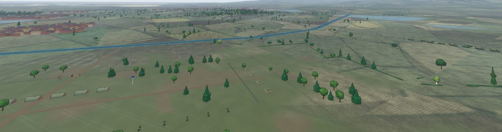 
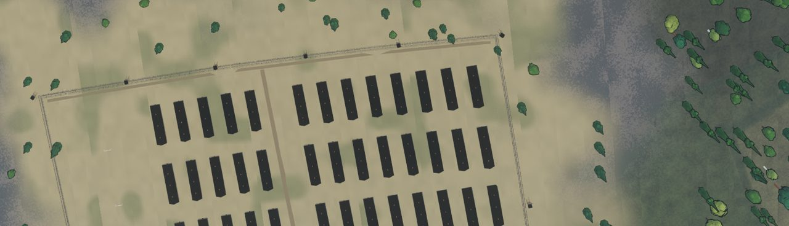 
A wired army camp beside a south-coast fighter station · Stalag VI-A at Hemer

## 🗓️ The war on the ground

Pick a date for your sortie and the map shows that day of the war. Nothing is a static backdrop:

- **Bomb damage that builds up.** The London docks are intact in August 1940 and cratered and burnt by October. Coventry, Portsmouth, Plymouth, Rotterdam, the Ruhr towns, Cologne, Caen, Saint-Lô, Le Havre and 40-odd more places show their damage from the date it happened: rubble, gutted blocks, scorched streets and crater fields.
- **1940 invasion fears.** Fields near the English coast are blocked with poles and zig-zag trenches against glider landings from the summer of 1940 until 1942.
- **The 1944 build-up.** Vehicle parks lining the roads behind the south coast, landing craft packed into the harbours and anchorages, Phoenix caissons waiting off Selsey and Dungeness, and concrete embarkation hards.
- **Normandy after D-Day.** The Mulberry harbours at Arromanches and Omaha (the Omaha one wrecked by the storm from 20 June), churned invasion beaches, gliders on the landing zones, the flooded Merderet and Dives valleys, and the burnt-out wrecks of Goodwood and Villers-Bocage.
- **Into the Low Countries and the Reich.** Walcheren flooded behind its broken dykes, the Arnhem and Nijmegen landing zones, the Westwall's dragon's teeth, and the Arnhem and Remagen bridges dropping into the river on the dates they fell.
- **Farmland that changes with the region and the season.** Small hedged bocage fields in Normandy, big open fields in Picardy and on the chalk, long polder strips in Holland, and the small fields and woods of the Weald. Stooks in August, ricks through the winter, brown ploughland in October.
- **Life at low level.** Barges and Rhine barge trains on the canals and rivers, steam from the locomotives, the Kammhuber Line searchlights across the Netherlands in 1941-42, and a brown industrial haze over the Ruhr and London.

Prisoner-of-war and labour camps stay where they were, as static scenery, never as targets.

<table>
<tr>
<td>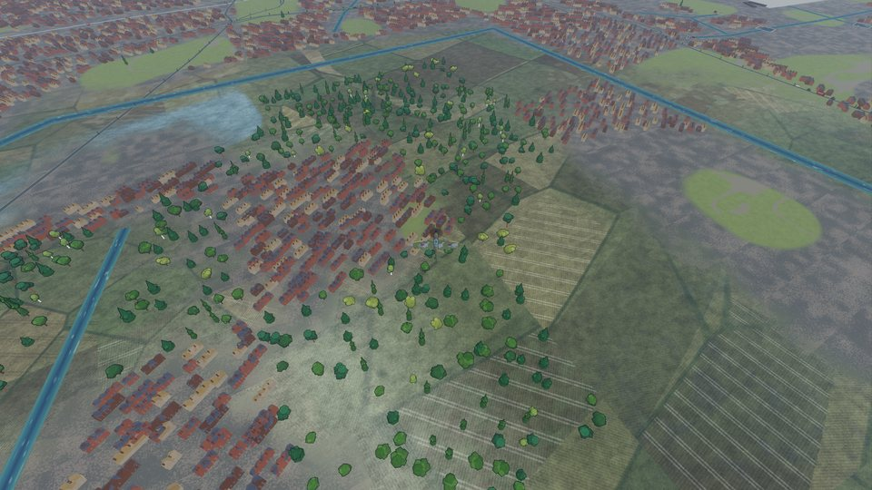</td>
<td>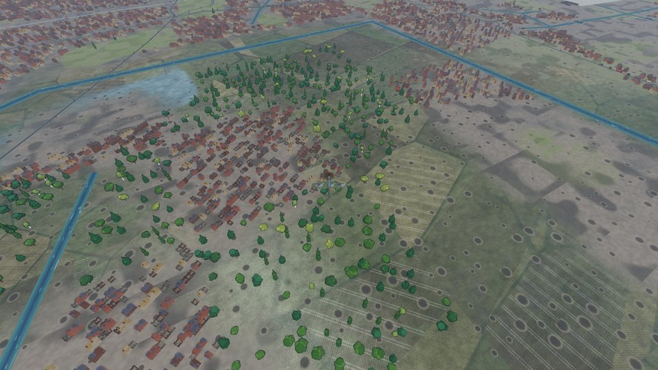</td>
</tr>
<tr>
<td>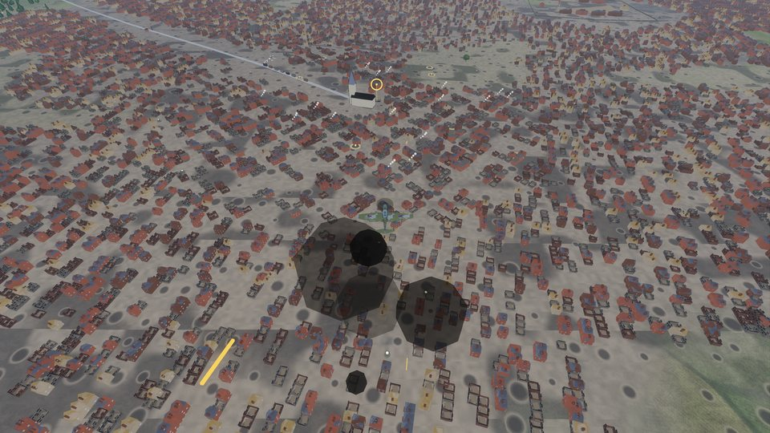</td>
<td>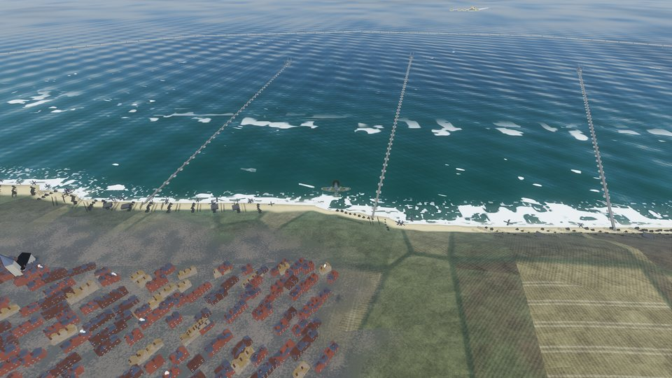</td>
</tr>
<tr>
<td>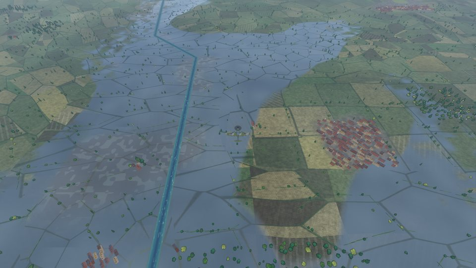</td>
<td>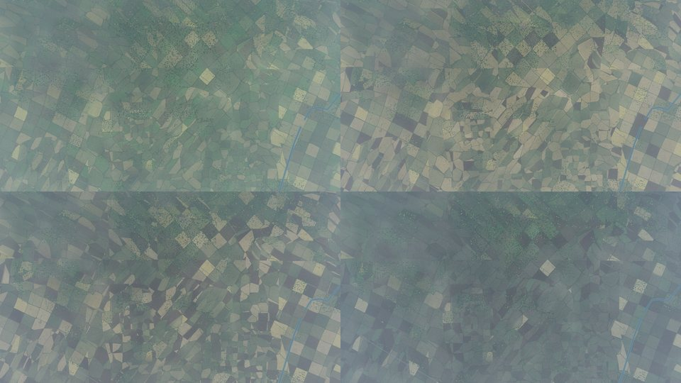</td>
</tr>
<tr>
<td>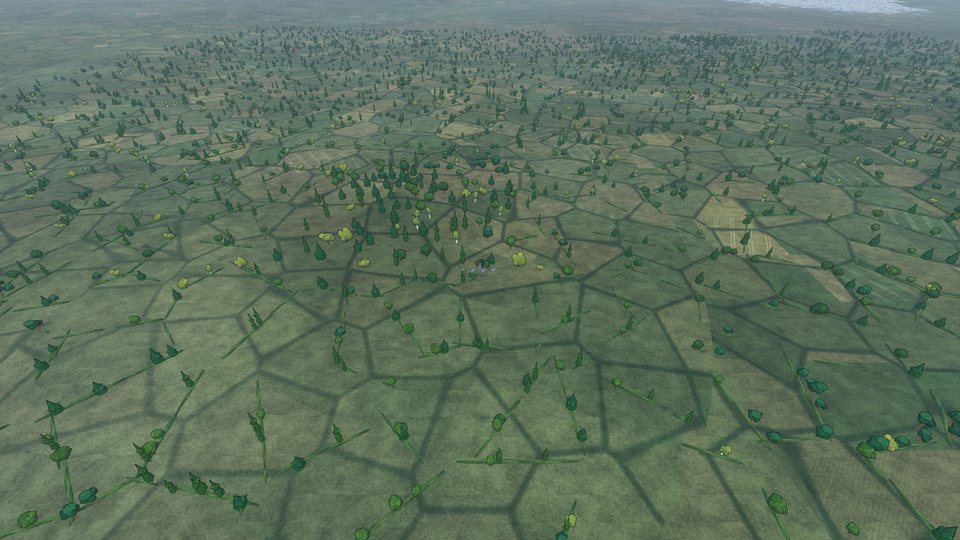</td>
<td>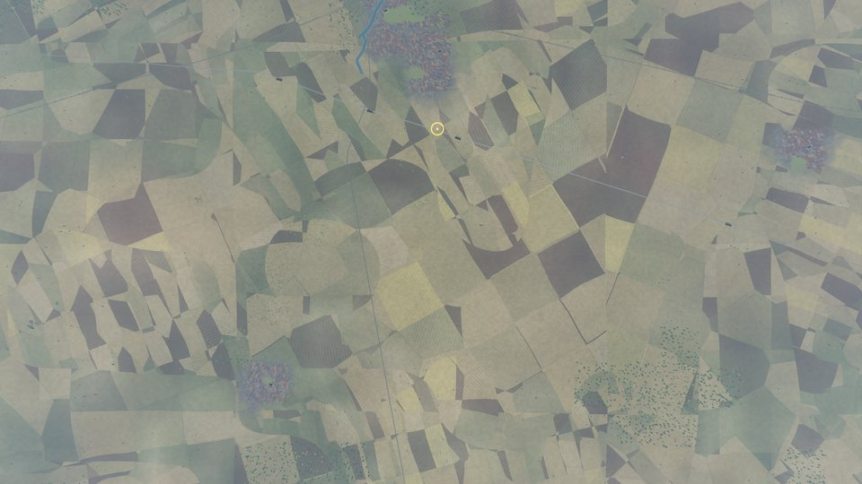</td>
</tr>
</table>
London docks in August and October 1940 · Caen in July 1944 · Mulberry B · the flooded Merderet · Kent through the seasons · Normandy bocage · open fields in Picardy

## 🎮 Play it in 3 steps

1. Download **`WW2ChannelAirWar_Setup_v2.14.exe`** from [Releases](../../releases/latest) (or the zip if you like things portable).
2. Run it. It installs just for you, with no admin rights needed.
3. Read the photosensitivity warning (it matters), accept the licence, and take off.

**Upscaling:** the game uses AMD FSR 2 (Options > Render) to render at a lower resolution and sharpen it back up, which works on any modern graphics card. Turn it off for native resolution.

## ✈️ The aircraft

All 25 aircraft were rebuilt for v2.0 and checked against photographs and the published dimensions of the real machines. The paintwork follows wartime photos too: matt period camouflage colours (RAF Dark Green and Ocean Grey, Luftwaffe splinter over mottled sides, Olive Drab), the right roundel types and fin flashes, squadron codes and Luftwaffe numbers, yellow leading-edge strips, and panel seams with rivet rows. They have real wingspans and fuselage shapes, rounded fins, spinners, twisted prop blades, exhaust stubs, radiators, oleo gear legs with tyres and hubs, cannon barrels, aileron gaps, glazed turrets, and D-Day stripes painted onto the skin.

| | |
|---|---|
|  |  |
| **Supermarine Spitfire** | **Hawker Hurricane** |
|  |  |
| **Hawker Typhoon** | **North American P-51 Mustang** |
|  |  |
| **Messerschmitt Bf 109** | **Messerschmitt Me 262** |
|  |  |
| **Avro Lancaster** | **North American B-25 Mitchell** |
|  |  |
| **Close up: C1 roundel, squadron codes, panel seams** | **Close up: Bf 109 mottled sides and outlined number** |

<b>See all 25 aircraft</b>

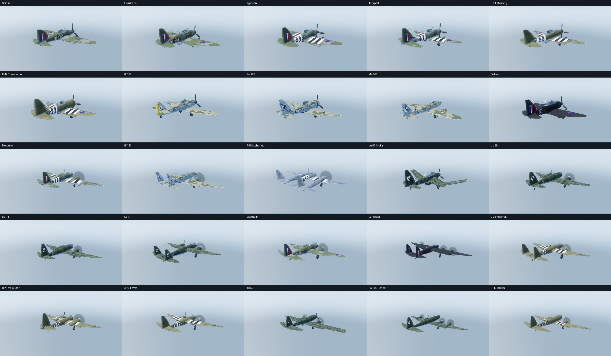

## 🛩️ In the hangar

- **Modes:** dogfight, bombing run, ground attack, bomber escort, defend, fighter sweep, free flight, plus training lessons for the nervous.
- **74 missions:** historical ones (Battle of Britain, Dieppe, D-Day, Dunkirk, Antwerp, Lille, Le Havre, V-1 sites, the Seine bridges) glow green once you've completed them, and **30 originals** (marked ◆) cover dawn patrols, convoy cover, night interceptions, steel for the Ruhr, jet hunts and armour on the road.
- **Sortie planner:** start from any airfield (runway or airborne) or any point on the map, choose a scenario, set the enemy strength.
- **A living world:** barrage balloons, searchlights, Atlantic Wall guns, convoys and trains. Landmarks include Battersea Power Station, the Tower of London and Rochester Castle.
- **Radio chatter:** AI-voiced controllers, wingmen and bomber crews, with subtitles and static.
- **Realism (Options > Realism, on by default):**
  - **Engine heat:** full throttle and boost heat the engine. Throttle back or dive to cool it. Overheat too much, too often, and the engine wears: less power, then smoke and fire. A new HEAT arc (and a wear arc) sits on the airspeed dial.
  - **G-forces:** sustained high G closes your vision in from the edges (red-out on negative G). Ease off and it returns slowly. Keep pulling and you black out, your hands come off the stick, and you had better wake up before the ground does.
  - **AI pilots follow the same rules,** so enemies manage their power and can black out in a hard turn.
- **Fighters that fight like fighters:** AI pilots choose their moves from range, angle, closure, height and energy: **boom-and-zoom** dives from the high side, **high and low yo-yos** to stop an overshoot or cut a corner, **barrel-roll attacks**, **Immelmanns**, **split-S** and **wingovers**, and **energy fighting** (extend, climb, come back from above). When you're on their tail they **break turn**, **barrel roll** so you overshoot, fly **scissors** when both are slow and close, **unload and extend**, or **spiral** away when they've run out of energy. Learn to read them.
- **Bomber streams and convoys:** bombers fly staggered-V formations with real defensive turrets. Each gun has an arc, so the gaps between them are genuine blind spots, and the underside is the safe way in against all but the heavies. Under attack the leader **weaves** and the whole stream follows. At sea, **ship convoys** (freighters, colliers, trawlers, landing craft, destroyers, cruisers and battleships) sail in columns along real routes, with wakes and slow sinkings, and road convoys, trains and tank columns roll on land. Missions ask you to cover them, or to wreck them.
- **Bailing out:** abandoned aircraft fly on out of control and crash. Multi-seat aircraft drop the right number of parachutes. Shoot or ram enemy parachutists if you can stomach it.
- **Smarter dogfights:** the first wave comes later and from further out, and some waves are patrols that haven't spotted you, so you can sneak up on them.
- **Safer airfields:** AI aircraft are protected until they have climbed to 50 m, and nothing is placed on the runways.
- **Cockpit, chase, orbit and overhead cameras,** and a clean no-HUD view (`H`) for screenshots.
- **Full gamepad support.** 🕹️

## ⌨️ Controls

| | Keyboard | Gamepad |
|---|---|---|
| Pitch / roll | `W` `S` / `A` `D` | Left stick |
| Yaw | `Q` `E` | Right stick look |
| Throttle | `Shift` / `Ctrl` | Triggers |
| Boost | `Tab` | `RB` |
| Bail out (hold) | `J` | |
| Time warp (in flight or under the parachute) | `]` `[` | |
| Fire / drop bomb | `Space` | `A` |
| Switch weapon | `X` / `B` | `B` |
| Gear | `G` | `Y` |
| Camera | `C` | `X` |
| Auto-level | `R` | `LB` (assist) |
| Time of day / weather | `T` / `Y` | D-pad |
| Outlines / HUD / hints | `O` / `H` / `F1` | D-pad |
| Photo (clean screenshot, saved to Pictures) | `F12` | |
| Pause / respawn | | `Start` / `Back` |

## 🗺️ Roadmap

- **Proper in-cockpit views:** fully modelled, detailed cockpit interiors for every aircraft, including the bombers' crew positions. The current cockpit cameras are a stand-in and will be replaced at a later point.
- More historical missions and the full Dam Busters campaign (both marked work in progress in the menus).
- More realism options and aircraft detail as the game grows.

## ❓ Quick answers

- **Is it really free?** Yes, completely. Donations are optional.
- **Will it run on my PC?** It needs 64-bit Windows and a reasonably modern graphics card.
- **Is there multiplayer?** No, it's single player.
- **Is it safe?** The source is right here: read it yourself, nothing is hidden. The game has a photosensitivity warning, a licence screen and a privacy policy.

## 🤖 Honest disclosure

This project was **vibecoded**: all of the code was written by AI. The art is generated procedurally
inside the engine (no hand-drawn assets, no photographed textures), the menu paintings are AI-generated,
and the radio voices are AI text-to-speech from [ElevenLabs](https://elevenlabs.io). There are no human
voice recordings in the game. The music is royalty-free from [Pixabay](https://pixabay.com), and the world
comes from open data (see below). It's a work of fiction inspired by real history.

## 🔧 Under the bonnet

Built on **standard Godot 4.7 (GDScript)**, compiled from the official source with double-precision coordinates (`precision=double`) so the 954 km map stays rock-steady far from the origin. AMD FSR 2 upscaling.
From v2.6 it uses a **double-precision** build of that fork. See [engine/BUILDING-ENGINE.md](engine/BUILDING-ENGINE.md)
for how to build it, and [engine/CHANGELOG.md](engine/CHANGELOG.md) for the engine fixes.
Terrain uses `data/heightmap/region_height.png` + `region_meta.json`; the Python tools in `tools/`
(see `tools/README.md`) rebuild the map from Sentinel-2, ESA WorldCover, AWS Terrain Tiles and OpenStreetMap.

- Run the missions checker: `python tools/validate_missions.py`
- Add or edit original missions: `tools/add_original_missions.py` (idempotent)
- Build the installer: `ISCC.exe installer\setup.iss` (per-user install, no administrator rights needed)
- Legal texts live in `docs/legal/`; fill in the publisher and contact in `tools/build_legal.py` and run it to refresh `data/legal.json`
- More notes for developers: [HANDOFF.md](HANDOFF.md), [SPEC.md](SPEC.md)

## 🎵 Credits

Full credits and licences are in the game (**Credits** button on the main menu) and in
[ATTRIBUTION.md](ATTRIBUTION.md).

- **Music** (Pixabay Content Licence): "Freedom" by [jeremusic70](https://pixabay.com/users/jeremusic70-25199461/) · "Rise of Shadows", "Race Against Time", "Cinematic Violin Tribal", "Rise of the Titans" and "Battle Cry of the Brave" by [nocopyrightsound633](https://pixabay.com/users/nocopyrightsound633-47610058/) · "Cinematic Action Movie Music", "Epic Orchestral Music with Flute" and "Suspenseful Thriller Music" by [musicwallah](https://pixabay.com/users/musicwallah-51797968/) · "Cinematic War" and "Trailer War" by [The_Mountain](https://pixabay.com/users/the_mountain-3616498/) · "Military - War Military" and "Epic - Epic Battle" by [YevhenAstafiev](https://pixabay.com/users/yevhenastafiev-52618283/) · "Hero Heroic Patriotic" by [NastelBom](https://pixabay.com/users/nastelbom-48128234/) · "Danger and Resolution" by [MUPHFI](https://pixabay.com/users/muphfi-36181755/) · "Remembering Our Veterans" by [Luis_Humanoide](https://pixabay.com/users/luis_humanoide-12661853/) · "Swing That Jazz - 1940s Big Band Dance Music" by [kaazoom](https://pixabay.com/users/kaazoom-448850/) · "Epic Military March – Heroic Snare Drum Theme" by [DesiFreeMusic](https://pixabay.com/users/desifreemusic-28163210/)
- **Terrain imagery:** [Sentinel-2 cloudless 2020](https://s2maps.eu) by EOX IT Services GmbH (CC BY 4.0), containing modified Copernicus Sentinel data 2020
- **Land cover:** [ESA WorldCover 10 m 2021](https://esa-worldcover.org) (CC BY 4.0)
- **Elevation:** [AWS Terrain Tiles](https://registry.opendata.aws/terrain-tiles/)
- **Roads, rail, rivers, woods, towns:** © [OpenStreetMap](https://www.openstreetmap.org/copyright) contributors (ODbL)
- **Water:** Ocean3D Lite by Justin Schroeder (MIT) · **Fonts:** Barlow by Jeremy Tribby (SIL OFL 1.1)
- **Engine:** Godot (MIT), with AMD FidelityFX Super Resolution 2 (MIT).

## ☕ Support

Enjoying it? There's a **Support me on PayPal** button in the top-right of the main menu. Totally optional, always appreciated.

## 📜 Licence

This is a personal project. All rights reserved: see [LICENCE](LICENCE), and the in-game licence agreement
and privacy policy (`docs/legal/`). Third-party data and audio carry their own licences, listed above.

*Chocks away!* 🛫
