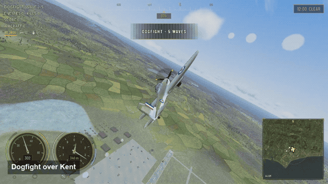
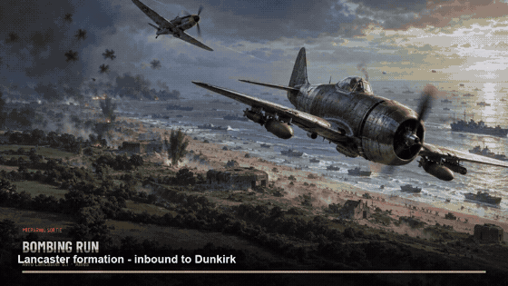
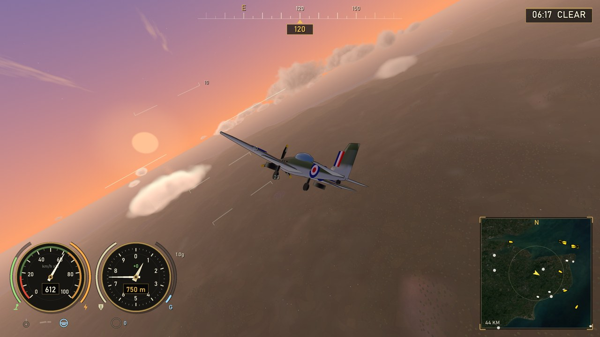
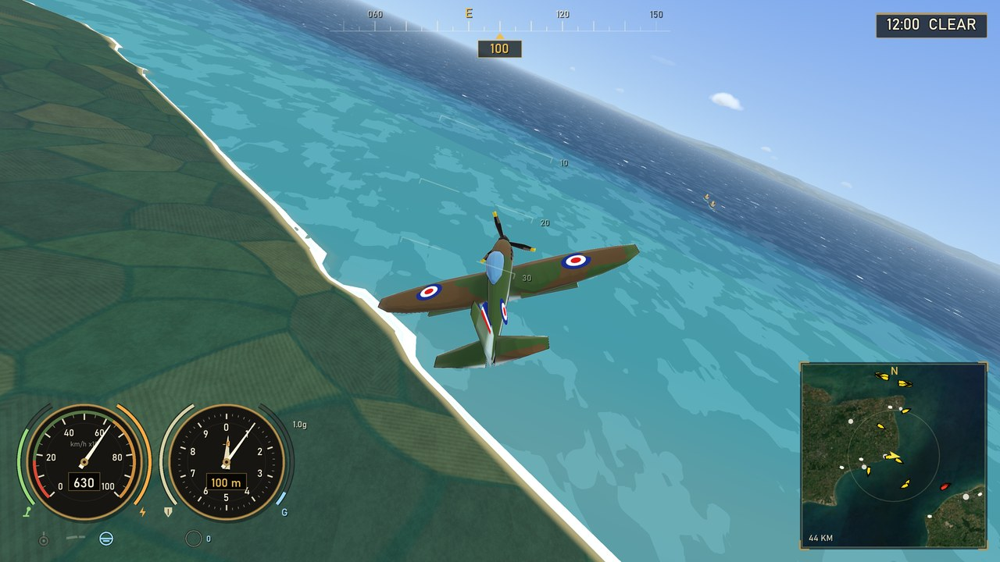
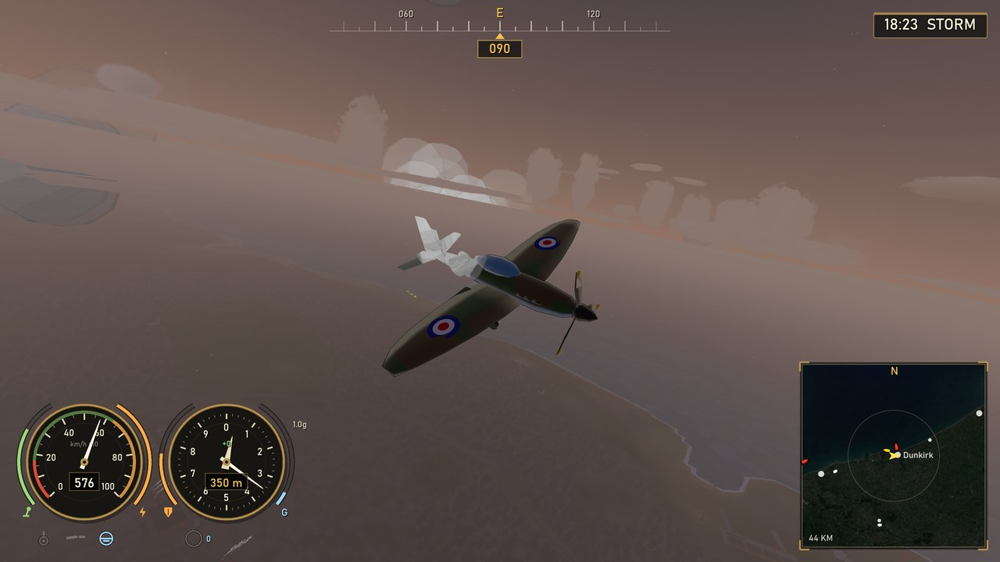
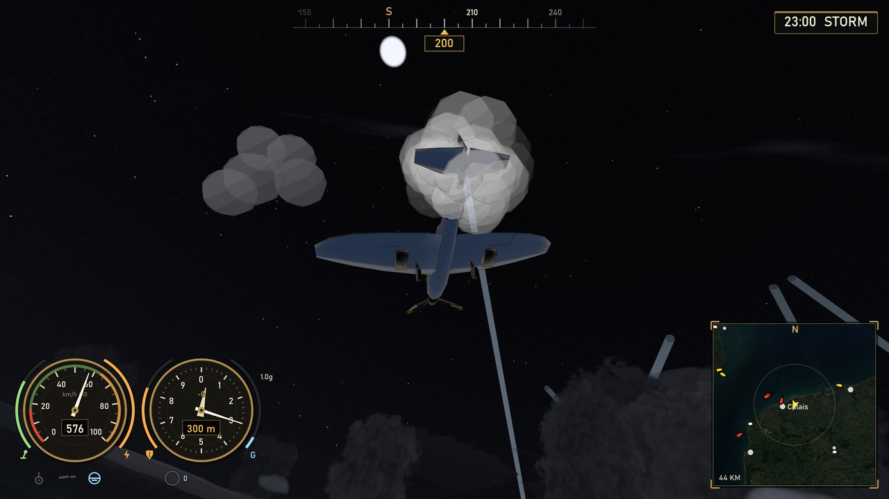

# WW2 Channel Air War

Arcade, cell-shaded WW2 flight game set in a real-scale (1 unit = 1 m) recreation of
the Channel theatre, 1940–44: southern England up to the Midlands, the English Channel, Northern
France, Belgium, the Netherlands and the Rhineland (about 954 × 453 km).
Built on the NVIDIA RTX Godot fork (4.8-dev, GDScript) — DLSS and
frame generation included. Pick the Allies or the Axis and fly fighters and
bombers over real airfields, towns, roads, rivers and coastlines.

> **Disclosure: this project was vibecoded.** All of the code was written by AI, and
> every asset is either generated procedurally in-engine or is a free / copyright-free
> work. Voice acting is generated with [ElevenLabs](https://elevenlabs.io), the music is
> royalty-free from [Pixabay](https://pixabay.com) (track list below), and the world data
> comes from CC-BY / ODbL-licensed sources listed in [ATTRIBUTION.md](ATTRIBUTION.md).
> There are no hand-drawn assets, no photographed textures and no copyrighted material.

## Demo

Footage from a live session, captured in Godot's Movie Maker mode (1280x720, 30 fps, scored with a
royalty-free Pixabay track). Click the preview to play the full video.

Dawn scramble from RAF Manston · a low pass through the Dover Barrage at dusk · a dogfight over Kent ·
a night raid over the Pas-de-Calais · the Möhne dam · barrage balloons over London.

**▶ [Full 31-second video (8 MB)](docs/demo/channel-air-war-demo.mp4)**

### Bomber Command, with radio voice

A Lancaster formation inbound to Dunkirk · a fighter patrol over Kent · the tail gunner's station. The
radio calls are the game's own recorded voice set, composited over the score (the Movie Maker recorder
captures video only).

**▶ [Full 17-second video (5 MB)](docs/demo/channel-air-war-bombers.mp4)**

## Screenshots

In-game captures (1280x720):

| Dawn over Kent (right-stick orbit camera) | Kent coastline |
|:---:|:---:|
|  |  |

| Dunkirk at dusk | Night flak over Calais |
|:---:|:---:|
|  |  |

## Features

- Both sides: **Allies** (Spitfire, Hurricane, Typhoon, Mosquito, P-51, Lancaster...) and **Axis** (Bf 109, Fw 190, Ju 87, He 111, Me 262...) with national markings
- Modes: dogfight, bombing run, ground attack/strafing, bomber escort, defend, historical missions (Battle of Britain, Dieppe 1942, D-Day 1944, Dunkirk 1940, Antwerp, Lille, Le Havre, V-1 sites, Seine bridges) and free flight
- **Sortie planner:** pick any airfield (runway or airborne) or any point on the map, then a scenario — free flight, bombing run, ground strike, boat strike, bomber escort or fighter sweep — and the enemy strength
- **Dynamic campaign:** a single-pilot career where every sortie moves the war (air strength, industry, bombed targets, enemy raids), with ranks, daily sortie offers and a saved state
- **25 original missions** (diamond-marked) with scripted ambushes, raids and flybys, alongside the historical set.
- Destructible airfield buildings and parked aircraft; five airfield layouts; farms and hedgerows that follow the field boundaries
- Real world: RAF Manston, Biggin Hill, Hawkinge, Tangmere, Calais-Marck, Abbeville, Caen and more — with live traffic (convoys, trains, cars), ports, Atlantic Wall defences, AA guns, searchlights and barrage balloons
- **Real rivers with water** — the OpenStreetMap waterway network drawn as terrain-hugging water ribbons that stream with the terrain and are carved into the heightmap, so the banks read from the air
- **1940s waterfronts** — pleasure piers (Brighton, Southend...), harbour piers, dock basins and locks, dry docks and shipyards, river quays and fishing harbours, keyed to real locations (`data/docks_1940.json`)
- **1940s industry** — gasworks (the gasholder silhouettes), collieries with pit head-frames, mills, breweries, power stations with cooling towers, shipyards, goods/marshalling yards, engine sheds, waterworks, cement works and coal staithes, each oriented to the nearest railway with a siding (`data/industry_1940.json`)
- **Landmark skylines** — period silhouettes wired into the towns: Battersea Power Station, the Tower of London, Rochester Castle, Lille's Hôtel de Ville belfry, Brussels' Palais de Justice and more
- **Streets, districts and skylines** — towns built along their real streets, with commercial cores, suburbs, civic centres and water-facing quays
- Weather (clear, scattered, overcast, rain, storm, fog) and time of day (dawn, noon, dusk, night)
- Radio with AI voice traffic, subtitles and static; bomber crew intercom
- Optional DLSS / FSR2 upscaling and frame generation (built on the NVIDIA RTX Godot fork — see HANDOFF.md); runs in standard Godot 4.3+ without them
- Full gamepad support

## Controls

**Keyboard:** W/S pitch, A/D roll, Q/E yaw, Shift/Ctrl throttle, Tab boost, Space fire
(guns, or release a bomb when bombs are selected), X or B switch weapon, G gear,
C camera, R auto-level assist, T time of day, Y weather, O outlines, H HUD, F1 hide hints.

**Gamepad:** left stick pitch/roll, right stick look, triggers throttle, A fire,
B switch weapon, Y gear, X camera, RB boost, LB assist, Back respawn,
D-pad time/weather/outlines/HUD, Start pause.

## Run

Download the latest release zip ([Releases](releases/latest)), unzip,
and run `WW2ChannelAirWar.exe`. Keep the NVIDIA DLLs next to the exe.
RTX GPU recommended for DLSS / frame generation; runs without them too.

Terrain uses `data/heightmap/region_height.png` + `region_meta.json` when present,
otherwise a procedural Kent/Channel/France fallback. The Python tools in `tools/`
(see `tools/README.md`) regenerate the map data from Sentinel-2, ESA WorldCover,
AWS Terrain Tiles and OpenStreetMap. The river network (`data/osm/rivers.json`) is
carved into the heightmap by `tools/carve_rivers.py` after `fetch_osm.py`, so the
water ribbons sit in real valleys; `tools/make_industry_1940.py` generates the
hand-authored 1940s industry/dock datasets (`data/industry_1940.json`, `data/docks_1940.json`).

## Credits

- **Voices** — generated with [ElevenLabs](https://elevenlabs.io)
- **Music** — royalty-free tracks from [Pixabay](https://pixabay.com) (Pixabay Content License):
  - ["Freedom"](https://pixabay.com/users/jeremusic70-25199461/) by **jeremusic70**
  - ["Rise of Shadows"](https://pixabay.com/users/nocopyrightsound633-47610058/), ["Race Against Time"](https://pixabay.com/users/nocopyrightsound633-47610058/), ["Cinematic Violin Tribal"](https://pixabay.com/users/nocopyrightsound633-47610058/), ["Rise of the Titans"](https://pixabay.com/users/nocopyrightsound633-47610058/) and ["Battle Cry of the Brave"](https://pixabay.com/users/nocopyrightsound633-47610058/) by **nocopyrightsound633**
  - ["Cinematic Action Movie Music"](https://pixabay.com/users/musicwallah-51797968/), ["Epic Orchestral Music with Flute"](https://pixabay.com/users/musicwallah-51797968/) and ["Suspenseful Thriller Music"](https://pixabay.com/users/musicwallah-51797968/) by **musicwallah**
- **World data** — full details in [ATTRIBUTION.md](ATTRIBUTION.md):
  - Terrain colour imagery: [Sentinel-2 cloudless 2020](https://s2maps.eu) (EOX IT Services GmbH, CC BY 4.0, tiles via [tiles.maps.eox.at](https://tiles.maps.eox.at)) — contains modified Copernicus Sentinel data 2020
  - Land cover: [ESA WorldCover 10 m 2021](https://esa-worldcover.org) (© ESA WorldCover project 2021, CC BY 4.0)
  - Elevation: [AWS Terrain Tiles](https://registry.opendata.aws/terrain-tiles/) (AWS Open Data, attribution to Mapzen/AWS)
  - Roads, rails, rivers, woods, towns: [OpenStreetMap](https://www.openstreetmap.org/copyright) contributors (ODbL)

## Licence

This is a personal project, shared for viewing only. All rights reserved:
no permission is given to copy, modify, redistribute or use it. Full
notice in [LICENCE](LICENCE). Third-party data and audio carry their own
licences as listed above.

## DLSS
NVIDIA DLSS is optional and is not shipped with the game. On NVIDIA RTX cards the game offers to download NVIDIA's components on first launch (or later in Options > Render); everywhere else it uses the standard renderer with AMD FSR 2 upscaling.

## Legal
See `docs/legal/` (EULA, privacy policy, credits). Fill in the publisher name and contact in `tools/build_legal.py`, then run it to regenerate `data/legal.json`.
