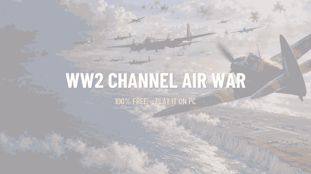
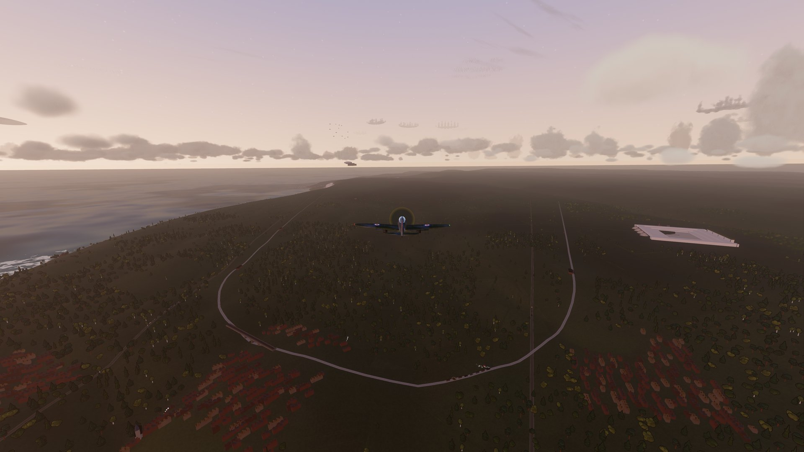
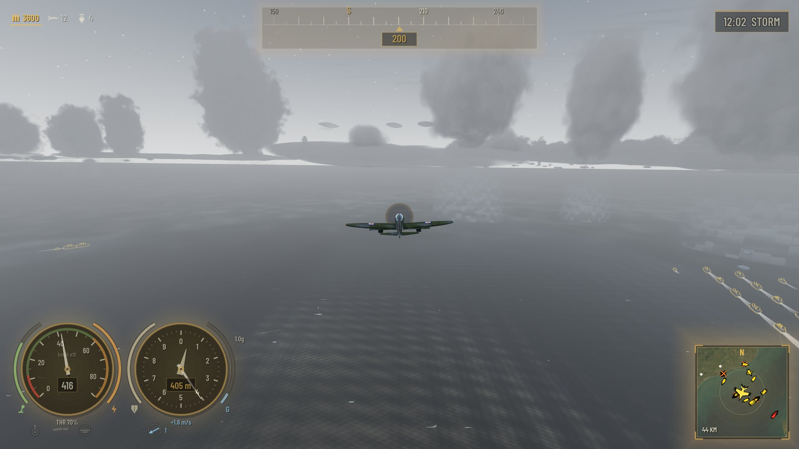
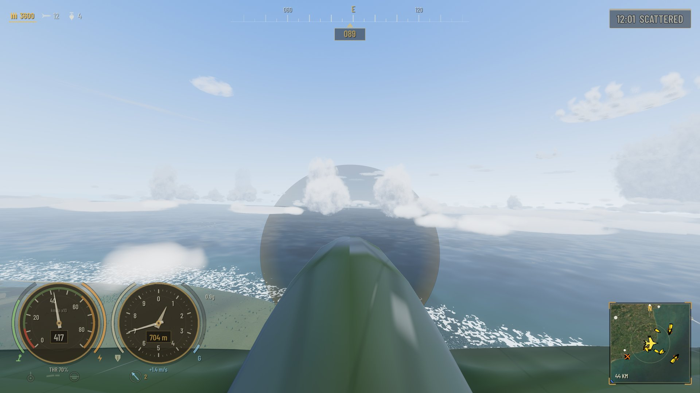
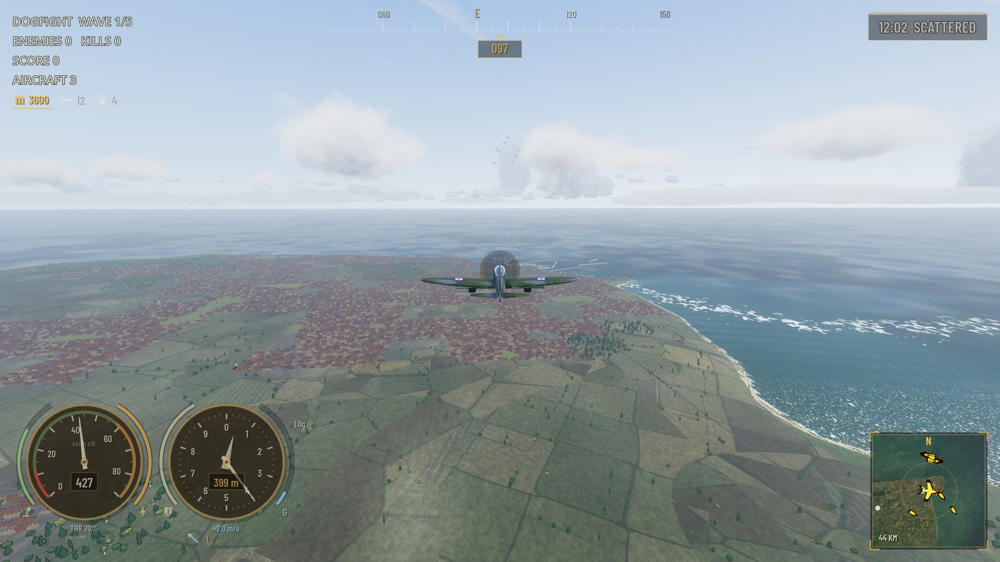
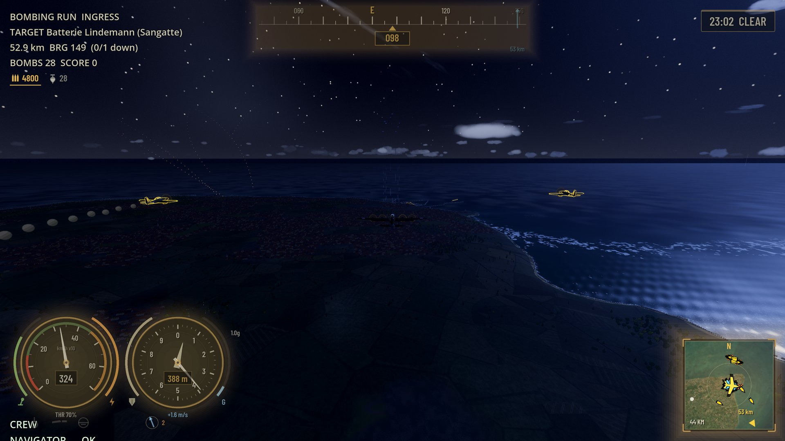
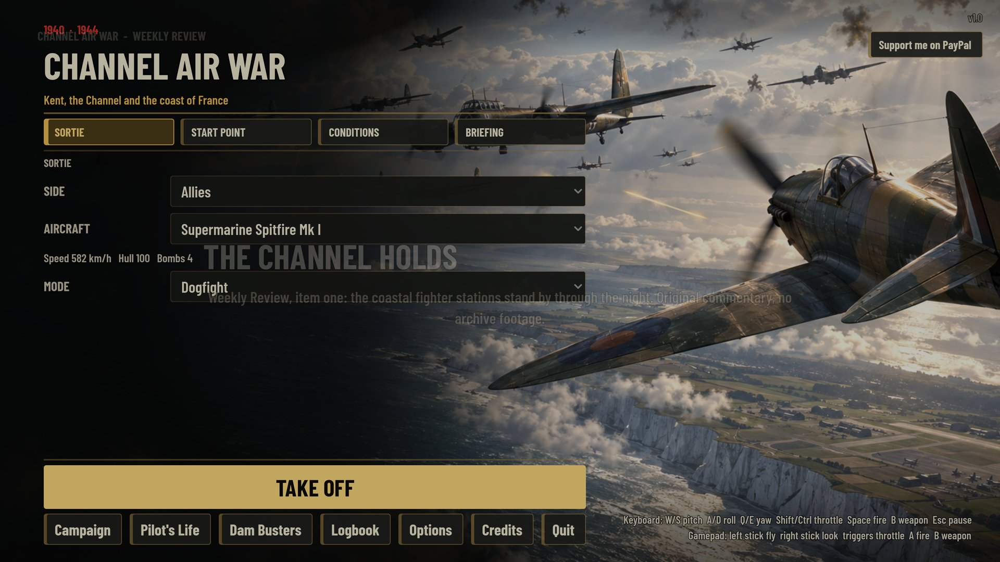

# ✈️ WW2 Channel Air War

### *"Scramble! Bandits over Dover, angels fifteen!"*

**A free, cell-shaded WW2 flight game over a real-scale slice of Europe.** 
Take off from Kent. Cross the Channel. Come home. Maybe.

   

**▶ [Watch the full promo with music](docs/promo/channel-air-war-promo.mp4)**

### [⬇️ Download the free installer](../../releases/latest)

---

## 🔥 Why you'll want to play

|  |  |
|---|---|
| 🌍 **Real-scale Europe** | **954 × 453 km** of England, the Channel, France, Belgium, the Netherlands and the Rhineland. Real airfields, towns, rivers, rail and ports. Fly from Kent to the Ruhr and it actually takes a while. |
| ✈️ **Two sides, two dozen aircraft** | Spitfire, Hurricane, Typhoon, Mustang, Lancaster and more for the Allies. Bf 109, Fw 190, Stuka, Me 262 and more for the Axis. Each one flies differently. |
| ⚔️ **Fly it your way** | Dogfights, bombing runs, ground attack, escorts, sweeps and free flight. Or just go sightseeing over the white cliffs. |
| 🌊 **Dam Busters** | A seven-day campaign. Skim low, hit your marks, put the bomb on the dam. |
| 🎖️ **A war that moves** | Dynamic campaign and Pilot's Life: ranks, medals, telegrams, newsreels, and the occasional letter home you hope you never have to send. |
| 🌦️ **Dawn to midnight, clear to storm** | Weather and time of day change everything: fog banks, rain squalls, searchlights and flak at night. |
| 🎵 **Bring your own soundtrack** | Import your own MP3, OGG or WAV tracks (Options > Music) and fly to your own playlist. |
| 💸 **Free. Really.** | No ads, no accounts, no microtransactions. If you enjoy it, [there's a tip jar](#-support). |

<table>
<tr>
<td></td>
<td></td>
<td></td>
</tr>
<tr>
<td></td>
<td></td>
<td></td>
</tr>
</table>
Dawn over Kent · Storm · Spitfire cockpit · Dogfight · Night raid · Main menu

## 🎮 Play it in 3 steps

1. Download **`WW2ChannelAirWar_Setup_v1.21.exe`** from [Releases](../../releases/latest) (or the zip if you like things portable).
2. Run it. It installs just for you, with no admin rights needed.
3. Read the photosensitivity warning (it matters), accept the licence, and take off.

**Got an NVIDIA RTX card?** The game offers to download **DLSS** (about 213 MB, straight from NVIDIA's own GitHub repo, checksum-verified). It's optional and makes everything faster and sharper. No NVIDIA card? You get the standard renderer with AMD FSR 2 upscaling.

## 🛩️ In the hangar

- **Modes:** dogfight, bombing run, ground attack, bomber escort, defend, fighter sweep, free flight, plus training lessons for the nervous.
- **74 missions:** historical ones (Battle of Britain, Dieppe, D-Day, Dunkirk, Antwerp, Lille, Le Havre, V-1 sites, the Seine bridges) glow green once you've completed them, and **30 originals** (marked ◆) cover dawn patrols, convoy cover, night interceptions, steel for the Ruhr, jet hunts and armour on the road.
- **Sortie planner:** start from any airfield (runway or airborne) or any point on the map, choose a scenario, set the enemy strength.
- **A living world:** barrage balloons, searchlights, Atlantic Wall guns, convoys and trains. Landmarks include Battersea Power Station, the Tower of London and Rochester Castle.
- **Radio chatter:** AI-voiced controllers, wingmen and bomber crews, with subtitles and static.
- **Cockpit, chase, orbit and overhead cameras,** and a clean no-HUD view (`H`) for screenshots.
- **Full gamepad support.** 🕹️

## ⌨️ Controls

| | Keyboard | Gamepad |
|---|---|---|
| Pitch / roll | `W` `S` / `A` `D` | Left stick |
| Yaw | `Q` `E` | Right stick look |
| Throttle | `Shift` / `Ctrl` | Triggers |
| Boost | `Tab` | `RB` |
| Fire / drop bomb | `Space` | `A` |
| Switch weapon | `X` / `B` | `B` |
| Gear | `G` | `Y` |
| Camera | `C` | `X` |
| Auto-level | `R` | `LB` (assist) |
| Time of day / weather | `T` / `Y` | D-pad |
| Outlines / HUD / hints | `O` / `H` / `F1` | D-pad |
| Photo (clean screenshot, saved to Pictures) | `F12` | |
| Pause / respawn | | `Start` / `Back` |

## ❓ Quick answers

- **Is it really free?** Yes, completely. Donations are optional.
- **Will it run on my PC?** It needs 64-bit Windows and a reasonably modern graphics card. RTX owners get optional DLSS.
- **Is there multiplayer?** No, it's single player.
- **Is it safe?** The source is right here. The game has a photosensitivity warning, a licence screen and a privacy policy.

## 🤖 Honest disclosure

This project was **vibecoded**: all of the code was written by AI. The art is generated procedurally
inside the engine (no hand-drawn assets, no photographed textures), the menu paintings are AI-generated,
and the radio voices are AI text-to-speech from [ElevenLabs](https://elevenlabs.io). There are no human
voice recordings in the game. The music is royalty-free from [Pixabay](https://pixabay.com), and the world
comes from open data (see below). It's a work of fiction inspired by real history.

## 🔧 Under the bonnet

Built on a custom **NVIDIA RTX Godot fork (4.8-dev, GDScript)** with DLSS, Streamline and frame generation.
Terrain uses `data/heightmap/region_height.png` + `region_meta.json`; the Python tools in `tools/`
(see `tools/README.md`) rebuild the map from Sentinel-2, ESA WorldCover, AWS Terrain Tiles and OpenStreetMap.

- Run the missions checker: `python tools/validate_missions.py`
- Add or edit original missions: `tools/add_original_missions.py` (idempotent)
- Build the installer: `ISCC.exe installer\setup.iss` (per-user install, so the DLSS download can write next to the game)
- Legal texts live in `docs/legal/`; fill in the publisher and contact in `tools/build_legal.py` and run it to refresh `data/legal.json`
- More notes for developers: [HANDOFF.md](HANDOFF.md), [SPEC.md](SPEC.md)

## 🎵 Credits

Full credits and licences are in the game (**Credits** button on the main menu) and in
[ATTRIBUTION.md](ATTRIBUTION.md).

- **Music** (Pixabay Content Licence): "Freedom" by [jeremusic70](https://pixabay.com/users/jeremusic70-25199461/) · "Rise of Shadows", "Race Against Time", "Cinematic Violin Tribal", "Rise of the Titans" and "Battle Cry of the Brave" by [nocopyrightsound633](https://pixabay.com/users/nocopyrightsound633-47610058/) · "Cinematic Action Movie Music", "Epic Orchestral Music with Flute" and "Suspenseful Thriller Music" by [musicwallah](https://pixabay.com/users/musicwallah-51797968/)
- **Terrain imagery:** [Sentinel-2 cloudless 2020](https://s2maps.eu) by EOX IT Services GmbH (CC BY 4.0), containing modified Copernicus Sentinel data 2020
- **Land cover:** [ESA WorldCover 10 m 2021](https://esa-worldcover.org) (CC BY 4.0)
- **Elevation:** [AWS Terrain Tiles](https://registry.opendata.aws/terrain-tiles/)
- **Roads, rail, rivers, woods, towns:** © [OpenStreetMap](https://www.openstreetmap.org/copyright) contributors (ODbL)
- **Water:** Ocean3D Lite by Justin Schroeder (MIT) · **Fonts:** Barlow by Jeremy Tribby (SIL OFL 1.1)
- **Engine:** Godot (MIT). NVIDIA DLSS and Streamline belong to NVIDIA and are downloaded by the player, never bundled.

## ☕ Support

Enjoying it? There's a **Support me on PayPal** button in the top-right of the main menu. Totally optional, always appreciated.

## 📜 Licence

This is a personal project. All rights reserved: see [LICENCE](LICENCE), and the in-game licence agreement
and privacy policy (`docs/legal/`). Third-party data and audio carry their own licences, listed above.

*Chocks away!* 🛫
